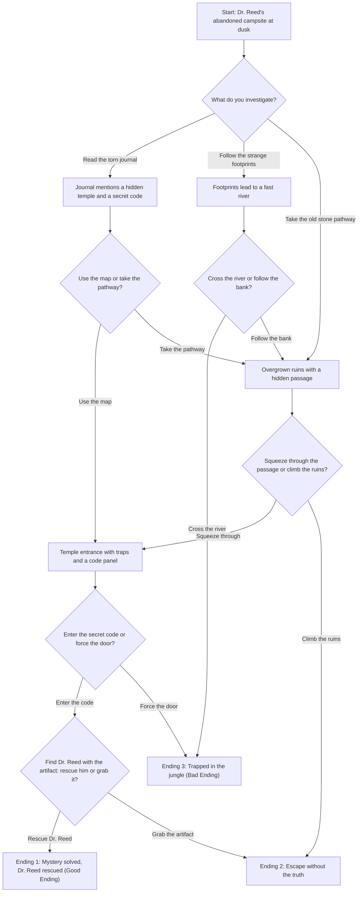

# The Lost Explorer

WEB 115 Final Project | Group 6

## Team Members and Roles

- Riyaa: README, flowchart, HTML
- Patrick: JavaScript, story logic, choices, navigation
- Hdung: Story writing, CSS

## Application Overview

### Story

You start playing the game being Bentley, a young adventurer and explorer, who goes into the jungle to rescue Dr. George Reed, a famous adventurer, who disappeared while exploring an ancient civilization in the Amazon rainforest. At the starting point, you discover a torn journal, a broken compass, and a strange map. All these clues show that Dr. Reed discovered an ancient temple, which contains an artifact protected by a secret code and traps.

### Gameplay

The player reads each scene and then presses a button to decide what to do next. The actions to perform are: which clue to follow, which way to go, how to overcome obstacles like river, secret passage, and temple traps. Some paths are shorter than others, and some choices lead to the same scene through another way. The game has three endings: good one, when Dr. Reed is rescued and the mystery is solved, escape ending, when the player escapes without finding the answer, and bad one, when the jungle wins.

### Rules and Navigation

- Players click choice buttons to advance the story.
- Clues from the journal and map can help the player later in the game.
- A restart button appears on ending screens so players can try a different path.

## Story Flowchart

